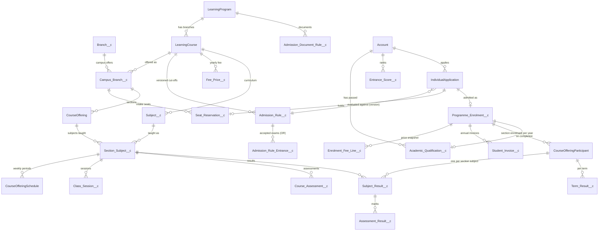
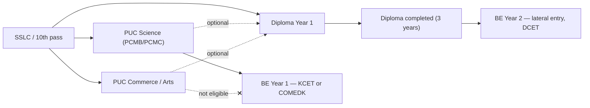
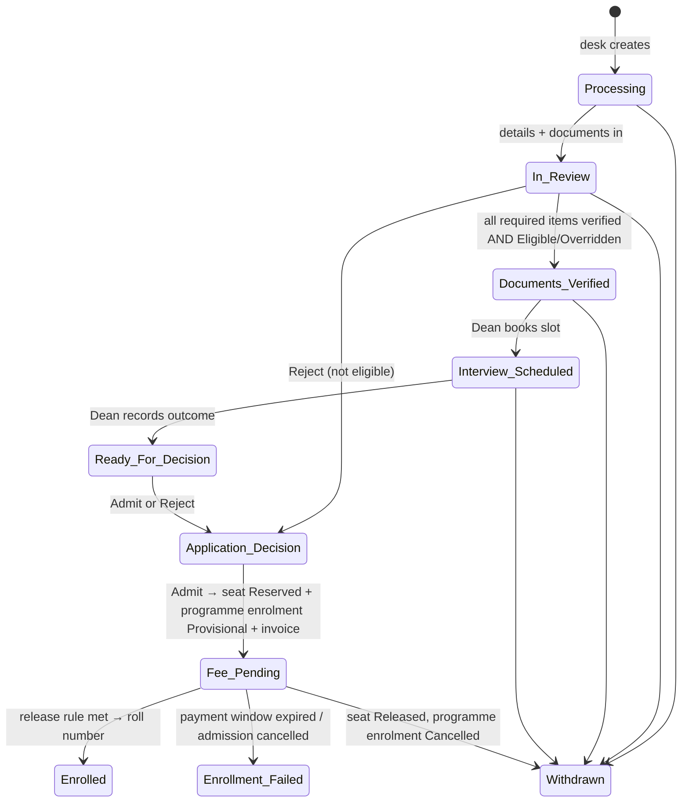
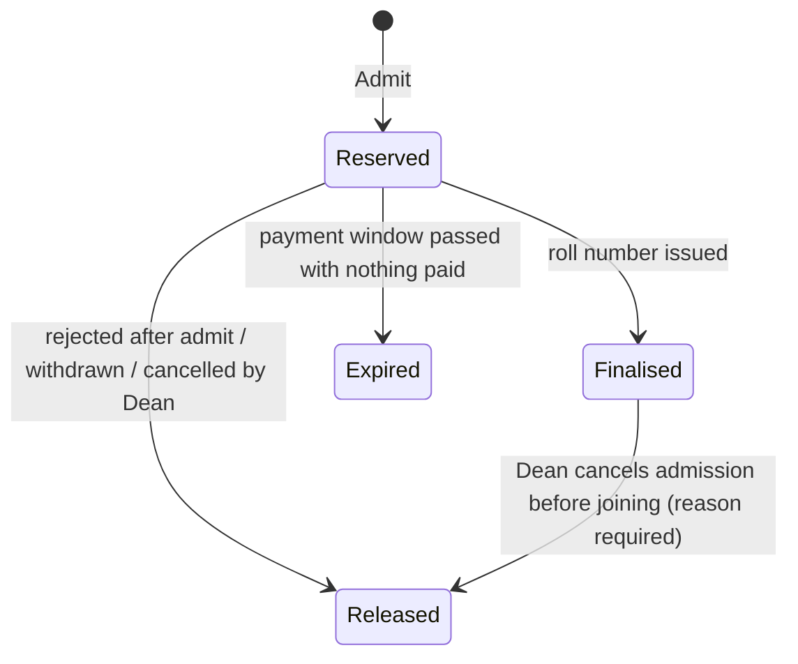
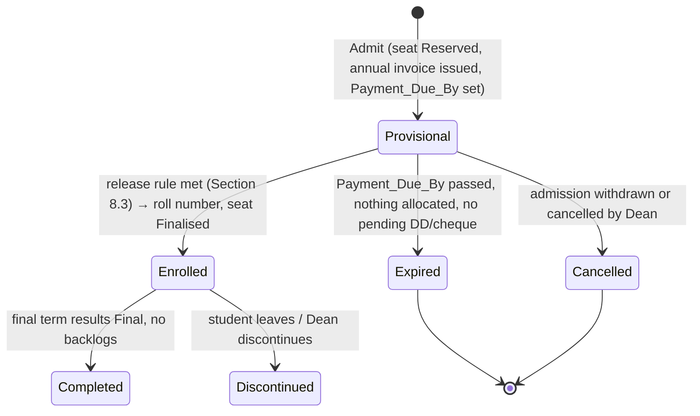

# KT College Mode — Plan and Design (version 2)

_Status: **Product design approved; technical architecture defined in C0; nothing built.** Version 2, 2026-10-13. No org changes have been made for this document. Architecture decision: [ADR-005](adr/ADR-005-college-mode-structure.md)._

This document turns the KTEdutech solution (built for after-school learning centres) into a **college** solution for two campuses that run PUC, Diploma and BE. It is the single reference for naming, data model, configuration, admission, seats, fees, roll numbers, teaching and results, security, constraints, service boundaries, the build plan and the demo script.

## 0. Change log

| Version | Date       | Change                                                                                                                                                                                                                                                                                                        |
| ------- | ---------- | ------------------------------------------------------------------------------------------------------------------------------------------------------------------------------------------------------------------------------------------------------------------------------------------------------------- |
| 1       | 2026-10-13 | Product design from the manager's admission flow and the business decisions.                                                                                                                                                                                                                                  |
| 2       | 2026-10-13 | C0 technical architecture after review: app-specific wording instead of global relabelling; custom programme enrolment as the billing anchor; versioned admission rules; seat reservations; section subjects and the result hierarchy; portal sharing and document controls; constraints; service boundaries. |

## 1. Design rules

1. **Additive.** College mode sits next to the existing learning-centre mode. A campus is either a _Learning Centre_ or a _College_ (`Branch__c.Institution_Type__c`). Object labels, existing screens and existing services keep their current behaviour for learning centres; college behaviour is selected by campus type and record type.
2. **Configurable at run time.** Cut-offs, entrance limits, documents, fees, seats and roll-number ranges are **custom-object records** edited from the _College set-up_ screen. Nothing college-specific is hard-coded, and no college rule needs a deployment.
3. **Explainable history.** Rules and prices are versioned or copied at the moment they are used, so every past decision and charge can be explained later.
4. **Hidden back office.** Configuration is administrator-only and is not shown in the demo.
5. **Keep it simple for the demo.** Section 17 lists what is deliberately left out.

---

## 2. Terminology (app-specific, not global relabelling)

Salesforce object labels are org-wide, so **no object is renamed**. The college words appear only inside the **KT College** app: its navigation items (Lightning app pages hosting college list components), its Lightning record pages (assigned by record type), custom labels and LWC text.

| College word (KT College app) | Meaning                                                                    | Examples                                 | Object (API name, label unchanged)              | Record type                         |
| ----------------------------- | -------------------------------------------------------------------------- | ---------------------------------------- | ----------------------------------------------- | ----------------------------------- |
| **Institution**               | The organisation                                                           | KT Edutech                               | The org + `Education_Setting__mdt`              | —                                   |
| **Campus**                    | A physical location                                                        | Yelahanka Campus, Rajajinagar Campus     | `Branch__c` (label stays _Branch_)              | — (`Institution_Type__c = College`) |
| **Programme**                 | Level of study                                                             | PUC, Diploma, BE                         | `LearningProgram`                               | —                                   |
| **Branch**                    | Discipline in a programme (for PUC, the stream/combination)                | Science PCMB, Commerce, CSE, Mechanical  | `LearningCourse` (label stays _Course_)         | `College_Branch`                    |
| **Campus branch**             | A branch offered at a campus for an academic year, with its intake         | Yelahanka · BE-CSE · 2026-27 · 120 seats | `Campus_Branch__c` (new)                        | —                                   |
| **Section**                   | One teaching group of a campus branch, year of study and academic year     | `YLK · BE-CSE · 2026-27 · Y1 · A`        | `CourseOffering` (label stays _Class_)          | `College_Section`                   |
| **Subject**                   | A paper in a branch's curriculum version                                   | 21MAT11 Engineering Mathematics I        | `Subject__c` (new)                              | —                                   |
| **Section subject**           | A subject taught to a section in a term by a faculty member                | Sec A · 21MAT11 · Sem 1 · Tara           | `Section_Subject__c` (new)                      | —                                   |
| **Admission**                 | One application to one campus branch and entry route                       | APP-000123                               | `IndividualApplication`                         | `College_Admission`                 |
| **Programme enrolment**       | The admitted student in a programme; billing anchor; holds the roll number | KT26YBCS001                              | `Programme_Enrolment__c` (new)                  | —                                   |
| **Section enrolment**         | The student in a section for one academic year                             | KT26YBCS001 in Sec A 2026-27             | `CourseOfferingParticipant`                     | —                                   |
| **Academic year**             | Admission/teaching year                                                    | 2026-27                                  | `Academic_Year__c` text, validated (Section 12) | —                                   |
| **Year of study / Term**      | Year in the programme / semester (or year for PUC)                         | BE Year 1, Sem 1                         | `Year_Of_Study__c`, `Term__c` numbers           | —                                   |
| **Entry route**               | Regular (Year 1) or Lateral (Year 2)                                       | Diploma → BE Year 2                      | `Entry_Route__c` picklist                       | —                                   |
| **Roll number**               | Permanent number in a programme                                            | KT26YBCS001                              | `Programme_Enrolment__c.Roll_Number__c`         | —                                   |

In the persona table the manager's word **"Admin" is the _Admission desk_** (the Admissions Counsellor persona), not the system administrator.

> "Yalahanka" is spelt **Yelahanka** (official locality name) everywhere.

### 2.1 Catalogue

Programmes and branches are institution-wide; each campus offers branches through `Campus_Branch__c` per academic year.

| Programme (code)  | Duration | Terms      | Branch (code)                                                          |
| ----------------- | -------- | ---------- | ---------------------------------------------------------------------- |
| **PUC** (`P`)     | 2 years  | 1 per year | Science PCMB (`PB`), Science PCMC (`PC`), Commerce (`CM`), Arts (`AR`) |
| **Diploma** (`D`) | 3 years  | 2 per year | CSE (`CS`), Mechanical (`ME`), Electrical (`EE`)                       |
| **BE** (`B`)      | 4 years  | 2 per year | CSE (`CS`), ECE (`EC`), Mechanical (`ME`), Civil (`CV`)                |

| Campus             | Code | Offers          |
| ------------------ | ---- | --------------- |
| Yelahanka Campus   | `Y`  | All 11 branches |
| Rajajinagar Campus | `R`  | All 11 branches |

2 campuses × 11 branches = **22 campus branches** for 2026-27.

---

## 3. Data model

### 3.1 Scope of change

- **13 new objects:** the 7 from version 1 (`Campus_Branch__c`, `Admission_Rule__c`, `Academic_Qualification__c`, `Entrance_Score__c`, `Programme_Enrolment__c`, `Roll_Number_Sequence__c`, `Subject__c`) plus **6 additional objects** from C0 (`Admission_Rule_Entrance__c`, `Admission_Document_Rule__c`, `Seat_Reservation__c`, `Section_Subject__c`, `Subject_Result__c`, `Term_Result__c`).
- **Extended existing objects:** `Branch__c`, `LearningProgram`, `LearningCourse`, `CourseOffering`, `CourseOfferingSchedule`, `Class_Session__c`, `CourseOfferingParticipant`, `IndividualApplication`, `Fee_Price__c`, `Enrolment_Fee_Line__c`, `Student_Invoice__c`, `Student_Payment__c`, `Course_Assessment__c`, `Assessment_Result__c`, `DocumentChecklistItem` (15 objects).
- **Record types (new):** `LearningCourse.College_Branch`, `CourseOffering.College_Section`, `IndividualApplication.College_Admission`.

### 3.2 Entity diagram



### 3.3 Relationship table (the joins every service relies on)

| Child                                                                | Parent field(s)                                                              | Type / rule                                                           |
| -------------------------------------------------------------------- | ---------------------------------------------------------------------------- | --------------------------------------------------------------------- |
| `Campus_Branch__c`                                                   | `Campus__c` (Branch\_\_c), `Branch__c` (LearningCourse)                      | Lookups, required; unique campus + branch + academic year             |
| `CourseOffering` (section)                                           | `Campus_Branch__c` (new), existing `Branch__c` = campus                      | Lookup, required for `College_Section`                                |
| `Section_Subject__c`                                                 | `Section__c` (CourseOffering), `Subject__c`                                  | Master-detail to section; unique section + subject + term             |
| `CourseOfferingSchedule`, `Class_Session__c`, `Course_Assessment__c` | `Section_Subject__c` (new)                                                   | Lookup; required on college sections; must belong to the same section |
| `CourseOfferingParticipant`                                          | `Programme_Enrolment__c` (new), `Academic_Year__c`, `Year_Of_Study__c`       | Lookup; unique programme enrolment + academic year                    |
| `Student_Invoice__c`, `Enrolment_Fee_Line__c`                        | `Programme_Enrolment__c` (new), `Year_Of_Study__c`                           | Lookup; college invoices have no section enrolment                    |
| `Student_Payment__c`                                                 | `Programme_Enrolment__c` (new, for reporting)                                | Lookup, set from the invoice                                          |
| `Subject_Result__c`                                                  | `Section_Enrolment__c` (COP), `Section_Subject__c`, `Programme_Enrolment__c` | Lookups; unique section enrolment + section subject + attempt         |
| `Assessment_Result__c`                                               | `Subject_Result__c` (new)                                                    | Lookup; set by the result service                                     |
| `Term_Result__c`                                                     | `Section_Enrolment__c`, `Programme_Enrolment__c`, `Term__c`                  | Unique section enrolment + term                                       |
| `Seat_Reservation__c`                                                | `Campus_Branch__c`, `Application__c`, `Programme_Enrolment__c`               | Unique per application                                                |
| `Academic_Qualification__c`                                          | `Student__c` (Account), `Source_Programme_Enrolment__c` (internal)           | Unique source programme enrolment (idempotent completion)             |

### 3.4 Programme enrolment: custom object (decided)

**Decision: custom `Programme_Enrolment__c`.** Standard `ProgramEnrollment` is not used anywhere in the code base; the portal model (ADR-003) resolves access in Apex, and the Education Cloud licence already behaves unexpectedly for standard education objects (View All/Modify All silently dropped on `CourseOffering`/`CourseOfferingParticipant`, see 03-security-model). A custom object gives full control over sharing, validation, record locking and portal exposure. If native analytics on `ProgramEnrollment` is needed later, a one-way sync can be added without changing the model.

Fields: `Student__c` (person Account), `Programme__c`, `Branch__c` (LearningCourse), `Campus__c`, `Campus_Branch__c`, `Application__c` (one per admission, enforced by unique `Application_Key__c` because Salesforce lookup fields cannot be unique), `Entry_Route__c`, `Entry_Year_Of_Study__c`, `Admission_Year__c`, `Academic_Year__c` (of admission), `Current_Year_Of_Study__c`, `Status__c`, `Payment_Due_By__c`, `Roll_Number__c` (Text 11, unique, external ID), `Roll_Issued_On__c`, `Joining_Date__c`, `Fee_Hold__c`, `Status_Reason__c`, `Completed_On__c`, `Discontinued_On__c`, `Confirmation_Sent__c`, `Expiry_Reminder_Sent__c`, `Active_Key__c` (Section 12). Lifecycle and material business fields use field history; technical uniqueness keys and idempotency flags do not, keeping within Salesforce's 20 tracked-field limit.

---

## 4. Background configuration (College set-up, administrator only)

All of these are custom-object records with field history; the College set-up screen edits them in user mode.

### 4.1 Programme — `LearningProgram` (new fields)

`Programme_Code__c` (1 letter, unique), `Duration_Years__c`, `Terms_Per_Year__c`, `Term_Label__c` (Year/Semester), `Qualification_Level__c` (PUC/Diploma/BE), `Roll_Release_Rule__c` (Section 8.3), `Roll_Release_Amount__c`, `Payment_Window_Days__c` (default 7), `Max_Backlogs_For_Promotion__c` (PUC 0, Diploma 2, BE 4 — seed values), `Active__c`.

### 4.2 Branch — `LearningCourse` (record type `College_Branch`, new fields)

`Programme__c`, `Branch_Code__c` (2 letters, unique within programme), `Stream_Group__c` (Science/Commerce/Arts — PUC), `Curriculum_Version__c` (current scheme, e.g. `2025`). The existing age fields stay blank for college branches.

### 4.3 Campus — `Branch__c` (new fields)

`Institution_Type__c` (Learning Centre default / College), `Campus_Code__c` (1 letter, unique among colleges), `Allowed_Payment_Methods__c` (multi-select: Demand Draft; Cheque; Online Gateway; UPI; Card; Bank Transfer — **Cash and Credit Note are never offered as choices**; credit notes are applied only by the credit service), `Discounts_Allowed__c` (false for colleges).

### 4.4 Campus branch — `Campus_Branch__c`

`Campus__c`, `Branch__c`, `Academic_Year__c`, `Intake_Regular__c`, `Intake_Lateral__c`, `Reserved_Regular__c`, `Reserved_Lateral__c`, `Finalised_Regular__c`, `Finalised_Lateral__c` (counters, system-managed), `Admissions_Open__c`, `Unique_Key__c`. Sections of the campus branch must have capacities adding up to at least the finalised count (checked at joining, Section 9).

### 4.5 Admission rules — `Admission_Rule__c` (immutable versions)

| Field                                                                                 | Meaning                                                                                                                      |
| ------------------------------------------------------------------------------------- | ---------------------------------------------------------------------------------------------------------------------------- |
| `Branch__c`, `Academic_Year__c`, `Entry_Route__c`, `Campus__c` (blank = all campuses) | The **logical rule**                                                                                                         |
| `Rule_Key__c`                                                                         | `branchId                                                                                                                    | year | route | campusId or ALL` — system-set, not unique |
| `Version__c`                                                                          | 1, 2, 3 … within the rule key — system-set                                                                                   |
| `Version_Key__c`                                                                      | `Rule_Key#Version` — **unique**                                                                                              |
| `Active_Key__c`                                                                       | = `Rule_Key` while Active, blank otherwise — **unique** (one Active version per logical rule; blanks are allowed many times) |
| `Status__c`                                                                           | Draft → Active → Superseded / Retired                                                                                        |
| `Effective_From__c`, `Effective_To__c`                                                | Set on activation / supersession                                                                                             |
| `Entry_Year_Of_Study__c`                                                              | 1 (Regular) or 2 (Lateral)                                                                                                   |
| `Qualifying_Level__c`                                                                 | SSLC / PUC / Diploma                                                                                                         |
| `Qualifying_Streams__c`                                                               | PUC: allowed stream groups (blank = any)                                                                                     |
| `Qualifying_Branch_Codes__c`                                                          | Diploma: allowed Diploma branch codes for lateral entry                                                                      |
| `Min_Percentage__c`                                                                   | 0–100                                                                                                                        |
| `Entrance_Required__c`                                                                | true → at least one `Admission_Rule_Entrance__c` must be satisfied                                                           |
| `Interview_Required__c`                                                               | Dean interview step                                                                                                          |
| `Used__c`                                                                             | Set when an admission is evaluated against this version                                                                      |

Rules:

- **Draft** versions are editable. **Activating** a draft (one service call, one transaction) sets the previous Active version of the same `Rule_Key` to **Superseded** (`Effective_To__c` = now) and the draft to **Active** (`Effective_From__c` = now). The unique `Active_Key__c` makes a second Active version impossible even under concurrency.
- **Active, Superseded and Retired versions are read-only** (validation + service). To change a cut-off, the administrator clones the active version into a new Draft (`Version + 1`), edits and activates it. Admissions already evaluated keep pointing at the version they used.
- **Precedence:** campus-specific Active version first; otherwise the all-campus (`ALL`) Active version; otherwise "admissions not open". Because each key has at most one Active version, the choice is deterministic.

`Admission_Rule_Entrance__c` (master-detail to the rule version, copied when a version is cloned): `Entrance_Exam__c` (KCET / COMEDK / DCET), `Max_Rank__c` (blank = any valid rank), `Min_Score__c` (optional), `Exam_Year_From__c` / `Exam_Year_To__c`. Unique per rule version + exam. **Any one** satisfied entrance passes (OR), each with its own limit.

**Seed 2026-27 (values for the demo; the administrator replaces them):**

| Branch                    | Route   | Needs             | Min % | Entrances (any one)             |
| ------------------------- | ------- | ----------------- | ----- | ------------------------------- |
| PUC Science PCMB / PCMC   | Regular | SSLC              | 75    | —                               |
| PUC Commerce              | Regular | SSLC              | 50    | —                               |
| PUC Arts                  | Regular | SSLC              | 40    | —                               |
| Diploma CSE               | Regular | SSLC or PUC (any) | 60    | —                               |
| Diploma Mech / Electrical | Regular | SSLC or PUC (any) | 50    | —                               |
| BE CSE                    | Regular | PUC Science       | 90    | KCET ≤ 20,000 · COMEDK ≤ 15,000 |
| BE ECE                    | Regular | PUC Science       | 80    | KCET ≤ 40,000 · COMEDK ≤ 30,000 |
| BE Mechanical             | Regular | PUC Science       | 65    | KCET (any) · COMEDK (any)       |
| BE Civil                  | Regular | PUC Science       | 60    | KCET (any) · COMEDK (any)       |
| BE CSE                    | Lateral | Diploma CS        | 75    | DCET ≤ 5,000                    |
| BE ECE                    | Lateral | Diploma CS or EE  | 65    | DCET (any)                      |
| BE Mechanical             | Lateral | Diploma ME        | 55    | DCET (any)                      |
| BE Civil                  | Lateral | Diploma ME        | 55    | DCET (any)                      |

"SSLC or PUC" for Diploma is two qualifying levels; the rule stores the **lowest acceptable level** (SSLC) and the engine accepts any higher level held (Section 5.2 step 2).

### 4.6 Document rules — `Admission_Document_Rule__c` (custom object, replaces metadata for colleges)

`Programme__c` (blank = all), `Entry_Route__c` (blank = both), `Qualifying_Level__c` (blank = any), `Academic_Year__c`, `Document_Type__c`, `Label__c`, `Instruction__c`, `Required__c`, `Sort_Order__c`, `Sensitive_Class__c` (Identity / Health / Academic / Financial), `Retain_File__c`, `Retention_Days__c`, `AI_Extractable__c`, `Active__c`. `Application_Checklist_Item__mdt` stays unchanged for learning centres.

At admission, the matching rules are **copied** into native `DocumentChecklistItem` rows (name, required, instruction, type), so later rule edits never change an existing checklist.

| Document                              | PUC | Diploma (from SSLC) | Diploma (from PUC) | BE Y1 (from PUC) | BE Y2 lateral | Class    | AI read | File kept after verification     |
| ------------------------------------- | :-: | :-----------------: | :----------------: | :--------------: | :-----------: | -------- | :-----: | -------------------------------- |
| Aadhaar card                          |  R  |          R          |         R          |        R         |       R       | Identity |   No    | **No** — deleted on verification |
| SSLC / 10th marks card                |  R  |          R          |         R          |        R         |       R       | Academic |   Yes   | Yes (programme + 1 year)         |
| Fitness (medical) certificate         |  R  |          R          |         R          |        R         |       R       | Health   |   No    | Yes (programme duration)         |
| Study certificate (1st–10th)          |  O  |          O          |         O          |        O         |       O       | Academic |   No    | Yes                              |
| PAN card                              |  O  |          O          |         O          |        O         |       O       | Identity |   No    | **No** — deleted on verification |
| PUC marks card                        |  –  |          –          |         R          |        R         |       –       | Academic |   Yes   | Yes                              |
| Diploma marks cards / certificate     |  –  |          –          |         –          |        –         |       R       | Academic |   Yes   | Yes                              |
| Entrance rank card (KCET/COMEDK/DCET) |  –  |          –          |         –          |        R         |       R       | Academic |   Yes   | Yes                              |

R = required, O = optional. The rank card is required whenever the evaluated rule version has `Entrance_Required__c`.

### 4.7 Fees — `Fee_Price__c` (existing, extended)

New billing frequency **Annual**; new `Year_Of_Study__c` (blank = every year) and `Academic_Year__c`. Seed 2026-27 tuition per year: PUC Science 60,000 · PUC Commerce/Arts 45,000 · Diploma 75,000 · BE CSE 1,50,000 · BE ECE 1,30,000 · BE Mechanical/Civil 1,10,000; one-time Admission fee 5,000. **Snapshot:** when an annual invoice is raised, the price, tax and fee price id are copied to `Enrolment_Fee_Line__c` (linked to the programme enrolment and year of study), exactly as section enrolments copy their agreed price today.

### 4.8 Roll-number ranges — `Roll_Number_Sequence__c` and settings

`Education_Setting__mdt` (deployment-level, rarely changed): `Roll_Prefix` = `KT`, `Roll_Regular_Range` = `001-400`, `Roll_Lateral_Range` = `401-999`. Sequences are records (Section 8.4).

---

## 5. Admission

### 5.1 Progression paths



| From                     | To      | Route   | Starts in | Years | Conditions                                          |
| ------------------------ | ------- | ------- | --------- | ----- | --------------------------------------------------- |
| SSLC                     | PUC     | Regular | Year 1    | 2     | SSLC % ≥ stream cut-off                             |
| SSLC or PUC (any)        | Diploma | Regular | Year 1    | 3     | % ≥ branch cut-off                                  |
| PUC **Science**          | BE      | Regular | Year 1    | 4     | PUC % ≥ cut-off **and** KCET or COMEDK within limit |
| PUC Commerce / Arts      | BE      | —       | —         | —     | **Not eligible**                                    |
| Diploma (allowed branch) | BE      | Lateral | Year 2    | 3     | Diploma % ≥ cut-off **and** DCET within limit       |

### 5.2 Eligibility engine — `AdmissionEligibilityService`

Triggered (system context, bulk-safe) when a college admission is created or its campus branch/route changes, when a qualification or entrance score is added or verified, and on demand from the screen. `ApplicationService.evaluateEligibility` keeps the age check for non-college applications and delegates `College_Admission` records.

1. **Rule:** campus-specific Active version, else ALL Active version (Section 4.5). None → `Not Eligible` ("Admissions are not open for this branch and route").
2. **Qualification:** the student's best **verified** `Academic_Qualification__c` at or above the rule's level (SSLC < PUC < Diploma). Missing → `Not Checked` ("Add the PUC result"). Stream or Diploma branch not allowed → `Not Eligible` with the reason.
3. **Percentage:** below `Min_Percentage__c` → `Not Eligible` ("BE-CSE needs 90 %; the student has 86 %").
4. **Entrance:** if required, any child entrance satisfied by a verified `Entrance_Score__c` of that exam within the year window and rank limit. None present → `Not Checked`; present but outside limits → `Not Eligible`.
5. **Pass** → `Eligible`.
6. **Evidence snapshot** (always): `Evaluated_Rule__c` (lookup to the exact version; sets `Used__c`), `Eligibility_Evidence__c` (JSON: version key, qualification id/level/%, entrance id/exam/rank, verdict, reasons, evaluated at, evaluated by), `Eligibility_Evaluated_On__c`. Re-evaluation overwrites the snapshot only while the admission is before `Application Decision`; afterwards it is frozen.
7. **Suggestions** (screen only, not stored): other branches at the same campus whose Active rules the student meets.

**Override:** existing `Overridden` status, existing **`KEM_Override_Eligibility`** custom permission (permission set `KEM_Eligibility_Override`), assigned **only to the Dean**. Reason mandatory; captured in the evidence snapshot. The interview permission does **not** include override authority.

### 5.3 Admission lifecycle (`IndividualApplication.Status`)

The business stages are **Documents Verified**, **Interview Scheduled**, **Fee Pending** plus the existing lifecycle stages. **C2 org finding (2026-10-14):** the native `IndividualApplication.Status` picklist does not expose the required college-only values. The deployed implementation therefore stores and governs this lifecycle in `College_Stage__c`; the existing `Status` remains unchanged for learning-centre compatibility. `Status_Transition__mdt` continues to govern the existing status, while the college services enforce the transitions below.



- `Documents Verified` is the **only** record of verification (no separate checkbox; a formula `Is_Documents_Verified__c` may read the status for reports).
- Interview fields: `Interview_Date__c`, `Interviewer__c`, `Interview_Outcome__c` (Pass/Reject), `Interview_Remarks__c`. Validation: an outcome requires interviewer and date; the date cannot be in the future when the outcome is recorded.
- Custom permission **`KEM_Conduct_Interview`** (schedule, record outcome, admit/reject college admissions).

---

## 6. Seat reservation (`Seat_Reservation__c`)

Fields: `Campus_Branch__c`, `Application__c` (one reservation per admission, enforced by the unique `Application_Key__c`), `Programme_Enrolment__c`, `Entry_Route__c`, `Status__c`, `Reserved_On__c`, `Expires_On__c`, `Finalised_On__c`, `Released_On__c`, `Release_Reason__c`, `Actioned_By__c`. Field history on status. Private; desk, Dean, Accounts and principal read; only `CollegeSeatService` writes. The college-specific name avoids colliding with the existing learning-centre `SeatService` used by course offerings and waitlists.



- **Locking:** every transition runs `SELECT … FROM Campus_Branch__c WHERE Id = :id FOR UPDATE`, then checks `Intake − Reserved − Finalised > 0` (per route) and updates the counters in the same transaction. Simultaneous admissions queue on the lock; the last seat cannot be given twice.
- **Idempotent:** `reserve(applicationId)` returns the existing reservation if one exists; every transition is a no-op if the reservation is already in the target state; the expiry job only touches `Reserved` rows past `Expires_On__c`.
- **Counters are reconciled** by the nightly job (recount from reservations; differences logged to `Error_Log__c` and corrected).
- A finalised seat released after joining is **not** refilled automatically; the Dean may raise intake.

---

## 7. Programme enrolment lifecycle



| Transition              | Who / what                    | Effects (one transaction)                                                                                                                                                                                                                                                           |
| ----------------------- | ----------------------------- | ----------------------------------------------------------------------------------------------------------------------------------------------------------------------------------------------------------------------------------------------------------------------------------- |
| → Provisional           | Dean admits                   | Seat Reserved; fee lines snapshotted; entry-year annual invoice issued; application `Fee Pending`; offer letter                                                                                                                                                                     |
| Provisional → Enrolled  | Payment allocation (system)   | Roll number; seat Finalised; application `Enrolled`; "Admission confirmed" message; joining task to the Dean                                                                                                                                                                        |
| Provisional → Expired   | Nightly job                   | Seat Expired; invoice Cancelled; application `Enrollment Failed`; message to student. **Not** expired while a `Pending` DD/cheque exists or any amount is allocated — those go to the Dean's _Overdue provisional_ list to **extend** (new due date, reason, audited) or **cancel** |
| Provisional → Cancelled | Dean or withdrawal            | Seat Released; unpaid invoice Cancelled; any confirmed money → credit note and the existing refund flow (two-person approval)                                                                                                                                                       |
| Enrolled → Discontinued | Dean                          | Active section enrolment withdrawn; future annual invoices not raised; open invoice handled by Accounts; roll number kept, never reused                                                                                                                                             |
| Enrolled → Completed    | Result service (Section 10.5) | Qualification created; programme enrolment closed                                                                                                                                                                                                                                   |

`Fee_Hold__c` is set (not a status) if a confirmed payment is later failed or refunded so that the release condition no longer holds; the roll number is **not** revoked automatically — Accounts and the Dean are notified.

---

## 8. Fees, payments and roll numbers

### 8.1 Billing anchor

New entry point `BillingService.createProgrammeInvoice(programmeEnrolmentId, yearOfStudy)` (permission `KEM_Manage_Billing`, plus a system variant for admission and promotion). It creates fee-line snapshots and an invoice with `Programme_Enrolment__c`, `Year_Of_Study__c`, `Invoice_Kind__c` (Annual / Admission) and no `Enrolment__c`. Existing `createInvoice(enrolmentId)` and the recurring job are unchanged and **refuse** section enrolments that belong to a programme enrolment ("billed through the programme enrolment"). One invoice per programme enrolment + year of study + invoice kind (unique key) — promotion and retries cannot double-bill. Under the default rule the admission fee is a line on the entry-year Annual invoice; under the _Admission fee_ release rule it is a separate Admission invoice.

**C3 implementation checkpoint (2026-10-14):** the alternative programme-enrolment anchors, invoice year/kind/key and exactly-one-anchor validations are deployed. `BillingService.createProgrammeInvoice` now snapshots the applicable programme prices and raises a retry-safe Annual or Admission invoice. Admission creates that invoice in the same rollback boundary as the provisional programme enrolment and seat reservation: _Admission Fee_ raises the separate Admission invoice; _Full Annual Invoice_ and _Minimum Amount_ raise the entry-year Annual invoice. The existing section-enrolment and recurring-billing paths remain covered by regression tests.

### 8.2 Methods, clearance, no cash, no discounts

- New method **Demand Draft**; new payment fields `Instrument_Number__c`, `Instrument_Bank__c`, `Instrument_Date__c` (required for DD and cheque).
- DD and cheque are recorded **Pending** (shown _Awaiting clearance_); Accounts confirms with the existing `BillingService.confirmPayment` when the bank credits them, or fails them if returned.
- Enforced at **every boundary**: `BillingService.recordPayment`, `PaymentApi`/`PaymentWebhookApi`, payment links, and `StudentPaymentTriggerHandler` (catches imports and direct DML) refuse a method not in the campus's `Allowed_Payment_Methods__c` — Cash can never be recorded at a college campus. `Credit Note` is allowed only when created by `CreditService`.
- Discounts: `Discounts_Allowed__c = false` hides the picker and the discount service and enrolment trigger refuse discounts for college campuses.

**C3 payment checkpoint (2026-10-14):** Demand Draft and the instrument number, bank and date fields are deployed. Cheques and demand drafts require all three details and are always first recorded as Pending. `BillingService`, the payment API and the `Student_Payment__c` trigger share the same college-campus policy: the method must be selected in `Allowed_Payment_Methods__c`, Cash is refused, and direct imports cannot bypass the rule. Credit Note payments require their source credit-note lookup. Payment links remain Online Gateway transactions and pass through the same service and trigger boundary.

### 8.3 Roll-number release rule

`LearningProgram.Roll_Release_Rule__c`:

| Value                          | Released when                                                                                                                                                                                                                                                                                                                                           |
| ------------------------------ | ------------------------------------------------------------------------------------------------------------------------------------------------------------------------------------------------------------------------------------------------------------------------------------------------------------------------------------------------------- |
| **Full annual invoice** (demo) | The entry-year invoice is **Paid**: `Balance_Due__c = 0`, where `Amount_Paid__c` sums `Payment_Allocation__c` rows. Allocations are created only for **Confirmed** payments (`BillingService.allocate` on confirmation) and for **authorised credit notes** applied by `CreditService`. Pending DD/cheques count for nothing; discounts are impossible. |
| Admission fee                  | The admission fee is raised as its own invoice at admit, and that invoice is Paid (same definition).                                                                                                                                                                                                                                                    |
| Minimum confirmed amount       | `Amount_Paid__c` on the entry-year invoice ≥ `Roll_Release_Amount__c`.                                                                                                                                                                                                                                                                                  |

The check runs inside the allocation transaction (after `refreshInvoices`), through `ProgrammeEnrolmentService.onInvoicesPaid(invoiceIds)`, so the roll number appears the moment the money is confirmed.

### 8.4 Roll number

```
KT 26 Y B CS 001   →   KT · admission year · campus · programme · branch · serial
```

| Example       | Meaning                                              |
| ------------- | ---------------------------------------------------- |
| `KT26YBCS001` | 2026, Yelahanka, BE, CSE, regular, first             |
| `KT26RPPB014` | 2026, Rajajinagar, PUC Science PCMB, 14th            |
| `KT26RBEC401` | 2026, Rajajinagar, BE ECE, first **lateral** entrant |

- `Roll_Number_Sequence__c`: `Key__c` (unique: `YY|campus|programme|branch|band`), `Next_Serial__c`, `Range_Start__c`, `Range_End__c`. Created on first use. Read `FOR UPDATE`; `Next_Serial__c > Range_End__c` → error "Roll-number range full" (regular 001–400, lateral 401–999), never a fourth digit or wrap-around.
- Idempotent: `issue(programmeEnrolmentId)` returns the existing number if already issued. `Roll_Number__c` is unique as a final guard.
- Never changes and never reused; a new programme (e.g. Diploma → BE) gets a new programme enrolment and number. `LearnerProfile.Student_Number__c` (STU-00001) stays the person number.

**C3 roll-release checkpoint (2026-10-14):** the roll prefix and regular/lateral ranges, private `Roll_Number_Sequence__c` ledger, locked `RollNumberService`, and allocation callback are deployed. After confirmed allocations refresh an entry-year college invoice, the service evaluates the programme's exact release rule. An eligible provisional enrolment atomically finalises its seat, consumes the next serial from the correct band, receives its immutable roll number and moves to Enrolled. Repeated callbacks and repeated `issue` calls are idempotent; sequence overflow is refused rather than wrapping or producing a fourth digit.

### 8.5 Messages (idempotent)

| Event                             | To                          | Channel                                                                                      | Idempotency                                                  |
| --------------------------------- | --------------------------- | -------------------------------------------------------------------------------------------- | ------------------------------------------------------------ |
| Payment confirmed                 | Student (+ linked parent)   | Existing `MessageService.paymentsReceived` + template `Fee_Received`; receipt PDF (existing) | Once per payment (existing per-payment call on confirmation) |
| Admission confirmed (roll number) | Student; Desk + Dean (bell) | Portal message; custom notification                                                          | `Programme_Enrolment__c.Confirmation_Sent__c`                |
| Provisional expiring (2 days)     | Student                     | Portal message                                                                               | `Expiry_Reminder_Sent__c`                                    |
| Expired / cancelled               | Student; Desk               | Portal message; bell                                                                         | Sent in the status transition only                           |

Email/SMS go out only when `Email_Delivery` is switched on.

### 8.6 Accounts view

Finance Desk **College dues** tab: campus → programme → branch → year: billed, paid (allocated), due, awaiting clearance, provisional at risk of expiry, fee holds.

---

## 9. Joining and sections

- The Dean opens **Joining** for an Enrolled programme enrolment: choose a `College_Section` of the same campus branch, year of study and academic year; set `Joining_Date__c`. `JoiningService` creates the section enrolment (`CourseOfferingParticipant` with `Programme_Enrolment__c`, academic year, year of study) using the existing seat control on the section, and creates a `Subject_Result__c` (Draft) for each active section subject of the first term.
- Unique programme enrolment + academic year on section enrolments: joining twice is a no-op.
- The section's `Teacher_User__c` is the **class mentor**; subject teaching is on section subjects.

---

## 10. Teaching and results

### 10.1 Section subject — `Section_Subject__c`

`Section__c` (master-detail), `Subject__c`, `Term__c`, `Faculty__c` (User), `Default_Room__c`, `Credits__c`, `Internal_Max__c`, `Exam_Max__c`, `Internal_Pass_Percent__c`, `Exam_Pass_Percent__c`, `Total_Pass_Percent__c`, `Start_Date__c`, `End_Date__c`, `Status__c` (Planned / Active / Results Final / Closed), `Unique_Key__c`. Defaults for marks come from `Subject__c`; they are copied so a later subject change does not alter a running term.

`Subject__c`: `Branch__c`, `Curriculum_Version__c`, `Subject_Code__c`, `Name`, `Year_Of_Study__c`, `Term__c`, `Credits__c`, mark defaults, `Active__c`; unique branch + curriculum version + subject code.

### 10.2 Timetable and attendance

Weekly periods (`CourseOfferingSchedule`) and sessions (`Class_Session__c`) carry `Section_Subject__c`; the faculty and room default from it (the F5.7 propagation now runs per section subject). Attendance is marked per session (existing) and reported per section subject and overall.

### 10.3 Result hierarchy

```
Section enrolment (CourseOfferingParticipant, one academic year)
  └─ Section subject (Section_Subject__c, one per subject per term)
       └─ Subject result (Subject_Result__c, one per student per section subject per attempt)
            └─ Assessment results (Assessment_Result__c → Course_Assessment__c, component Internal / Exam)
  └─ Term result (Term_Result__c, one per student per term)
```

- `Course_Assessment__c` gains `Section_Subject__c` and `Component__c` (Internal / Exam). `Assessment_Result__c` gains `Subject_Result__c`.
- **Subject result** (`Subject_Result__c`): `Internal_Marks__c` and `Exam_Marks__c` (each component's assessments scaled to `Internal_Max__c` / `Exam_Max__c` by weight), `Total_Marks__c`, `Percentage__c`, `Result__c` (Pass / Fail / Absent / Withheld), `Attempt__c`, `Status__c` (Draft / Final / Reopened), `Finalised_By__c`, `Finalised_On__c`, `Reopen_Reason__c`, `Reopened_By__c`, `Reopened_On__c`, `Reopen_Count__c`. **Pass** = every component ≥ its pass % and total ≥ total pass %; Absent if the exam component is marked absent.
- **Term result** (`Term_Result__c`): `Status__c` (Provisional / Final / Reopened), `Outcome__c` (Pass / Pass with backlog / Fail / Withheld), `Subjects_Passed__c`, `Backlogs__c`, `Total_Marks__c`, `Max_Marks__c`, `Percentage__c` (overall percentage = total ÷ max; **no SGPA/CGPA**). Pass = all subjects passed; Pass with backlog = failed subjects ≤ programme maximum; Fail otherwise.
- **Backlog**: a failed subject result stays as attempt 1; a re-attempt creates attempt 2 in a later term against the same subject (unique section enrolment + section subject + attempt). Backlogs count open failed subjects across the programme enrolment.
- The existing course-grade and report-card services **skip `College_Section` records**, so subjects are never averaged together.

### 10.4 Finalisation, publication and reopening

- Faculty enter marks (Draft). The Dean **finalises** (custom permission `KEM_Finalise_Results`) a section subject's results: all subject results become Final, `Section_Subject__c.Status__c = Results Final`. When every subject of the term is Final, term results are calculated and set Final.
- **Only Final results are visible in the portal** ("published"). Draft marks are never shown.
- **Locked:** a trigger refuses any edit to Final subject results, their assessment results and Final term results, except through `ResultService.reopen(subjectResultIds, reason)`.
- **Reopen** requires custom permission **`KEM_Reopen_Results`** (Dean only) and a reason; it sets Reopened, increments `Reopen_Count__c`, records who/when, moves the term result to Reopened (hidden from the portal with "Result under review"), and notifies the student. Re-finalising republishes and notifies again. Field history is tracked on marks, result and status fields.

### 10.5 Promotion, repeat, discontinue, completion

| Operation   | Condition                                                        | Effect                                                                                                                                                                                                           | Idempotency                                                    |
| ----------- | ---------------------------------------------------------------- | ---------------------------------------------------------------------------------------------------------------------------------------------------------------------------------------------------------------- | -------------------------------------------------------------- |
| Promote     | All term results of the year Final; backlogs ≤ programme maximum | Section enrolment Completed; new section enrolment for Year n+1 (next academic year); next annual invoice                                                                                                        | Unique programme enrolment + academic year; no-op if it exists |
| Repeat year | Backlogs above maximum, Dean decision                            | New section enrolment for the same year of study, next academic year; annual invoice for the repeat year                                                                                                         | Same unique key                                                |
| Discontinue | Dean decision with reason                                        | Section 7                                                                                                                                                                                                        | No-op if already Discontinued                                  |
| Complete    | Final year, all term results Final, **zero backlogs**            | Programme enrolment Completed; `Academic_Qualification__c` (level, stream/branch, % = total ÷ max over all subject results, year, `Source__c = Internal`, `Source_Programme_Enrolment__c`, `Verified__c = true`) | Unique `Source_Programme_Enrolment__c`                         |

Lateral entrants start at Year 2; their programme percentage covers the years studied at KT.

---

## 11. Security and privacy

### 11.1 Sharing (OWD and how access is granted)

| Object                                                                                                                                   | OWD (internal / external)  | Internal access                                                                                                                                                        | Portal access                                                                                                                                      |
| ---------------------------------------------------------------------------------------------------------------------------------------- | -------------------------- | ---------------------------------------------------------------------------------------------------------------------------------------------------------------------- | -------------------------------------------------------------------------------------------------------------------------------------------------- |
| `Campus_Branch__c`, `Subject__c`, `Section_Subject__c`, `Admission_Rule__c`(+entrance), `Admission_Document_Rule__c`                     | Public Read Only / Private | Read for staff; edit by permission (Section 11.2)                                                                                                                      | None directly; timetable data via `PortalService`                                                                                                  |
| `Roll_Number_Sequence__c`                                                                                                                | Private / Private          | No user access; `RollNumberService` system mode only                                                                                                                   | None                                                                                                                                               |
| `Programme_Enrolment__c`, `Seat_Reservation__c`, `Academic_Qualification__c`, `Entrance_Score__c`, `Subject_Result__c`, `Term_Result__c` | Private / Private          | Persona object permissions + View All for Desk, Dean, Accounts, Principal on the objects they need (11.2); Faculty read results of their section subjects through Apex | **No record sharing.** `PortalService` (without sharing, read-only queries) returns only rows whose student is in the caller's allowed-learner set |

**Portal access (ADR-003 pattern, extended):**

1. `PortalService` resolves the running user's Contact, then the allowed learners: **the student themselves**, plus learners linked to the caller by an **active** guardian `ContactContactRelation` with portal access.
2. Every portal query filters by that set; a requested learner id outside it is refused (the existing family switcher check).
3. A parent's access ends the moment the relationship is ended or the portal flag is removed — nothing to revoke, because no sharing rows exist.
4. Only **Final** results, the student's own invoices/payments, programme enrolment summary (programme, branch, campus, roll number, year) and their own timetable are returned.
5. **Files:** portal upload goes through `PortalService.uploadChecklistDocument(itemId, …)`: the item must belong to an admission of an allowed learner and still be open; the file is linked to the `DocumentChecklistItem` with internal visibility only. Downloads go through Apex with the same check and return base64 (existing pattern); students cannot download Identity-class files after upload.

### 11.2 Security matrix (C = create, R = read, E = edit; "via service" = Apex enforces the rule)

| Object / action                                                    | Admin |            Desk (Adam)             |             Dean (Anjali)             |      Faculty (Tara)       |    Accounts (Andrea)     | Principal (branch manager) |     Student / Parent (portal)      |
| ------------------------------------------------------------------ | :---: | :--------------------------------: | :-----------------------------------: | :-----------------------: | :----------------------: | :------------------------: | :--------------------------------: |
| College set-up (rules, fees, documents, campus branches, subjects) |  CRE  |                 R                  |                   R                   |       R (subjects)        |         R (fees)         |             R              |                 —                  |
| Admission, qualifications, entrance scores                         |  CRE  |                CRE                 |                  RE                   |             —             |            R             |             R              | own: view status, upload documents |
| Checklist documents (Academic)                                     |   R   |                CRE                 |                   R                   |             —             |            —             |             R              |            own: upload             |
| Checklist documents (Identity/Health)                              |   R   | CR + verify (then delete Identity) |                   R                   |             —             |            —             |             —              |          own: upload only          |
| Interview, admit/reject                                            |   —   |                 —                  |      ✅ `KEM_Conduct_Interview`       |             —             |            —             |             R              |                 —                  |
| Eligibility override                                               |   —   |                 —                  |     ✅ `KEM_Override_Eligibility`     |             —             |            —             |             —              |                 —                  |
| Seat reservation                                                   |   R   |                 R                  |    R + cancel/extend (via service)    |             —             |            R             |             R              |                 —                  |
| Programme enrolment                                                |   R   |                 R                  | RE (joining, discontinue via service) |     R (own sections)      |            R             |             R              |            own summary             |
| Invoices, payments, clearance                                      |   R   |                 R                  |                   R                   |             —             | CRE `KEM_Manage_Billing` |             R              |       own: view, pay online        |
| Sections, section subjects, timetable                              |  CRE  |                 R                  |                  CRE                  |          R (own)          |            —             |             R              |           own timetable            |
| Attendance                                                         |  RE   |                 R                  |                  RE                   |     CE (own sessions)     |            —             |             R              |                own                 |
| Marks (Draft)                                                      |   R   |                 —                  |                  RE                   | CE (own section subjects) |            —             |             R              |                 —                  |
| Finalise results                                                   |   —   |                 —                  |       ✅ `KEM_Finalise_Results`       |             —             |            —             |             —              |                 —                  |
| Reopen results                                                     |   —   |                 —                  |        ✅ `KEM_Reopen_Results`        |             —             |            —             |             —              |                 —                  |
| Final results                                                      |   R   |                 R                  |                   R                   |          R (own)          |            —             |             R              |                own                 |

Dean-only permissions go in a new permission set **`KEM_College_Dean`** (`KEM_Conduct_Interview`, `KEM_Finalise_Results`, `KEM_Reopen_Results`) plus the existing **`KEM_Eligibility_Override`** permission set — assigned to Anjali only, not to the Academic Coordinator persona group, so other coordinators do not receive them. The administrator is not a demo user and the admin column is for support only.

### 11.3 Sensitive documents

| Control          | Rule                                                                                                                                                                                                                                                                                                                                    |
| ---------------- | --------------------------------------------------------------------------------------------------------------------------------------------------------------------------------------------------------------------------------------------------------------------------------------------------------------------------------------- |
| Consent          | The New admission screen and the portal require a consent tick (privacy notice text in a custom label: purpose, retention, rights); stored on the admission with date/user.                                                                                                                                                             |
| Aadhaar / PAN    | Only `Last4__c` on the checklist item (`DocumentChecklistItem`: `Document_Type__c`, `Last4__c`, `Verified_By__c`, `Verified_On__c`, `AI_Result__c`, `File_Deleted_On__c`) is kept. The **file is deleted** by `DocumentVerificationService` when the item is marked Verified. The full number is never typed into or stored in a field. |
| Health (fitness) | Kept for the programme duration; visible to Desk and Dean only; never sent to AI.                                                                                                                                                                                                                                                       |
| Who can do what  | Upload: Desk, student/parent (own). View: Desk, Dean (Academic/Health), Admin. Replace: Desk while the item is not Verified. Delete: Admin, and the system per retention.                                                                                                                                                               |
| Retention        | Per document rule (`Retention_Days__c`); a scheduled job deletes expired files and records the deletion on the checklist item.                                                                                                                                                                                                          |
| Audit            | Field history on checklist status and verification fields; `Verified_By__c`, `Verified_On__c`; file deletions logged.                                                                                                                                                                                                                   |
| Downloads        | Staff download through Apex with the access check; Identity files have no portal download.                                                                                                                                                                                                                                              |
| Encryption       | Shield Platform Encryption is not assumed. The design avoids storing identity numbers, so encryption is not required for the demo; enabling Shield is a production decision (Section 14).                                                                                                                                               |
| AI               | Only `AI_Extractable__c` documents (marks and rank cards) are sent, through the Einstein Trust Layer (masking, zero retention), consistent with the existing document reader that excludes health and identity numbers. Extracted values are suggestions until a person verifies them.                                                  |

---

## 12. Data-quality constraints

| Constraint                                                                                 | Enforcement                                                                                       |
| ------------------------------------------------------------------------------------------ | ------------------------------------------------------------------------------------------------- |
| Academic year `YYYY-YY`, second = first + 1                                                | Validation rule (regex + value check) on every `Academic_Year__c`                                 |
| Campus code unique (colleges)                                                              | `Campus_Code_Key__c` unique (set only for colleges)                                               |
| Programme code unique                                                                      | Unique field                                                                                      |
| Branch code unique within programme                                                        | `Branch_Code_Key__c` = programme + code, unique                                                   |
| Subject code unique within curriculum version                                              | `Unique_Key__c` = branch + version + code                                                         |
| Campus branch unique per year                                                              | `Unique_Key__c`                                                                                   |
| Qualification % 0–100; year not in future                                                  | Validation                                                                                        |
| Rank > 0; exam year within rule window                                                     | Validation; engine check                                                                          |
| Interview outcome needs interviewer and date                                               | Validation                                                                                        |
| Entry year matches route                                                                   | Validation: Regular = 1, Lateral = 2 (rule, admission, programme enrolment)                       |
| One Active rule version per logical rule                                                   | `Active_Key__c` unique                                                                            |
| Rule versions immutable once Active                                                        | Validation + service                                                                              |
| One reservation per admission                                                              | `Application__c` unique on reservation                                                            |
| One programme enrolment per admission; no duplicate active enrolment in the same programme | `Application__c` unique; `Active_Key__c` = student + programme while Provisional/Enrolled, unique |
| One section enrolment per programme enrolment per academic year                            | Unique key                                                                                        |
| One invoice per programme enrolment + year of study + kind                                 | Unique key on invoice                                                                             |
| Roll number unique, range bounded                                                          | Unique field; sequence range check                                                                |
| Promotion / completion idempotent                                                          | Unique keys above; services return existing records                                               |
| Rule and price history                                                                     | Evidence snapshot on admission; fee-line snapshot on invoices                                     |
| Payment method allowed for campus                                                          | Service + trigger (Section 8.2)                                                                   |

---

## 13. Service boundaries

All services `with sharing`, user mode by default; named system-mode sections only where noted (as in the existing code).

| Service (new unless noted)            | Responsibility                                                                       | Entry points (callers)                                                               | Locks / system mode                                                                                           |
| ------------------------------------- | ------------------------------------------------------------------------------------ | ------------------------------------------------------------------------------------ | ------------------------------------------------------------------------------------------------------------- |
| `CollegeSetupService`                 | Catalogue, campus branches, rules (clone/activate/retire), document rules, fees      | College set-up LWC (admin)                                                           | Rule activation in one transaction                                                                            |
| `AdmissionEligibilityService`         | Rule selection, evaluation, evidence snapshot, suggestions                           | Application trigger (via `ApplicationService`), qualification/score triggers, screen | System-mode reads of rules and qualifications                                                                 |
| `DocumentVerificationService`         | College checklist creation, AI suggestions, verify, Identity deletion, retention job | Admission screen, portal upload, scheduled job                                       | File deletion in system mode, logged                                                                          |
| `InterviewService`                    | Schedule, record outcome, admit/reject                                               | Interview panel (Dean)                                                               | Calls `CollegeSeatService` and `ProgrammeEnrolmentService` in one transaction                                 |
| `CollegeSeatService`                  | Reserve, finalise, release, expire, reconcile                                        | `InterviewService`, `ProgrammeEnrolmentService`, nightly job                         | `FOR UPDATE` on campus branch; system-mode counters; separate from the existing learning-centre `SeatService` |
| `ProgrammeEnrolmentService`           | Provisional creation, release check, expiry/extend/cancel, discontinue, fee hold     | `InterviewService`, `BillingService` (after allocation), nightly job, Dean panel     | System mode for status fields                                                                                 |
| `RollNumberService`                   | Issue numbers                                                                        | `ProgrammeEnrolmentService` only                                                     | `FOR UPDATE` on sequence; system mode                                                                         |
| `BillingService` (existing, extended) | `createProgrammeInvoice`, annual lines, method enforcement, hook after allocation    | Services above; Finance Desk                                                         | Existing ledger `Writer`                                                                                      |
| `JoiningService`                      | Section enrolment, first-term subject results                                        | Joining panel (Dean)                                                                 | Existing section seat control                                                                                 |
| `ResultService`                       | Subject and term calculation, finalise, reopen, promotion, repeat, completion        | Gradebook (faculty), Dean panel                                                      | Lock trigger bypass only inside the service                                                                   |
| `PortalService` (existing, extended)  | Student/parent college views, document upload/download                               | `kemPortalHome`                                                                      | Without-sharing reads filtered by allowed learners                                                            |
| `MessageService` (existing)           | Fee received, confirmations, reminders                                               | Services above                                                                       | —                                                                                                             |

---

## 14. Implementation checks before the C1 deployment

C0 is documentation-only. Before anything is deployed, C1 must verify in the org (read-only or in a sandbox/scratch org):

1. **Standard-object extensibility:** custom fields and record types on `LearningProgram`, `LearningCourse`, `CourseOffering`, `CourseOfferingSchedule`, `IndividualApplication`; master-detail from `Section_Subject__c` to `CourseOffering` (fallback: required lookup + cascade in Apex). **C2 finding (2026-10-14):** the `College_Admission` record type can be deployed but native inserts fail with `INVALID_INPUT: License Type is a required field`. Runtime college admissions therefore use the working Admissions record type plus validated `College_Mode__c`; ADR-005 is reopened until Salesforce resolves or explains the native dependency.
2. **Lightning navigation:** app pages with college list components and record-type-assigned record pages show college wording without touching object labels; check the highlights panel header.
3. **Experience Cloud licensing:** Customer Community Plus count for student logins (and optional parents); Education Cloud for Experience Cloud permission set licence availability.
4. **Metadata behaviour:** new `IndividualApplication.Status` values and `Status_Transition__mdt` rows; unique fields on objects with existing data (backfill before making unique).
5. **Allocation timing:** confirm that allocations are written only on confirmation for every payment path (manual, gateway webhook, payment link, credit note) before relying on `Balance_Due__c` for the release rule.
6. **Shield Platform Encryption** availability, if production requires it.
7. **Org session:** the CLI session to `edu-org` has expired and must be re-authenticated by the user.

---

## 15. Build plan

| Phase  | Scope                                                                                                                                                                                                                                           | Done when                                                                                                          |
| ------ | ----------------------------------------------------------------------------------------------------------------------------------------------------------------------------------------------------------------------------------------------- | ------------------------------------------------------------------------------------------------------------------ |
| **C0** | This document and ADR-005 (documentation only)                                                                                                                                                                                                  | Consistency review passed; ADR-005 Accepted                                                                        |
| **C1** | Section 14 checks; institution type and campus settings; programmes, branches, campus branches; subjects and curriculum versions; sections and section subjects; record types, KT College app and pages; validation and uniqueness              | Both campuses, 22 campus branches, sections with subjects and faculty visible in the KT College app                |
| **C2** | Qualifications, entrance scores, versioned rules with entrances, eligibility + evidence + suggestions, document rules and checklist, verification and AI, interview, seat reservation; negative, bulk, permission and concurrency tests         | 86 % refused with suggestions; 92 % + KCET reaches Fee Pending with a reserved seat                                |
| **C3** | Provisional programme enrolment, fee snapshot, programme invoices, DD/cheque clearance, method and discount enforcement at every boundary, release rule, roll numbers, expiry job, idempotent messages, College dues                            | DD → clearance → roll number `KT26YBCS001`; cash refused everywhere; unpaid provisional expires and frees the seat |
| **C4** | Joining, section-subject timetable and attendance, assessments by component, subject and term results, finalise/reopen, promotion/repeat/discontinue/completion, internal qualification                                                         | Results finalised and locked; promotion creates Year 2 once; completion creates the qualification once             |
| **C5** | Student-first portal (programme, roll number, today's timetable, attendance and Final results by subject, dues and online payment, secure upload), optional parent access; cross-family negative tests                                          | A student sees only their own data; a parent only linked children                                                  |
| **C6** | Seed data, persona UAT, licence confirmation before creating users, clean-environment deployment, full Apex + Jest regression (results recorded in TEST-LOG.md), data migration and rollback plan, walkthrough and support guide with usernames | The demo (Section 16) runs end to end with non-admin logins                                                        |

For the first manager review, **C1 → C2 → C3** carries the whole story the manager described.

---

## 16. Demo script (outline, 20 minutes)

| #   | Log in as (usernames in [NEXT-STEPS](NEXT-STEPS.md)) | Show                                                                                                                                                             |
| --- | ---------------------------------------------------- | ---------------------------------------------------------------------------------------------------------------------------------------------------------------- |
| 1   | **Adam Admissions** — Admission desk                 | New admission at Yelahanka, BE-CSE regular. PUC 86 % → not eligible, suggestions shown. A 92 % applicant with KCET 12,400 → eligible. Consent; upload documents. |
| 2   | (same screen)                                        | AI reads marks and rank cards; one mismatch flagged; desk verifies; Aadhaar file removed, last four digits kept → _Documents Verified_.                          |
| 3   | **Anjali Advisor** — Dean                            | Schedule and record the interview, **Admit** → seat reserved, provisional enrolment, invoice ₹1,55,000, pay by date.                                             |
| 4   | **Andrea Advancement** — Accounts                    | Record a DD (awaiting clearance); try _Cash_ → refused. Clear the DD → receipt; College dues updates.                                                            |
| 5   | **Adam** / **Anjali**                                | "Admission confirmed" notification; roll number **KT26YBCS001**; Dean joins the student to Section A.                                                            |
| 6   | **Student** (portal)                                 | Roll number, today's timetable, attendance by subject, nothing due, Final results, upload a pending document, the fee-received message.                          |
| 7   | **Tara Teacher** — Faculty                           | Today's periods, attendance, internal marks; Dean finalises → the student sees the result.                                                                       |
| 8   | **Adam** (optional)                                  | Diploma CSE graduate with DCET → BE-CSE Year 2 → `KT26YBCS401`; PUC Commerce → BE refused.                                                                       |

The administrator (Kasetti Tech) is never used in the demo.

---

## 17. Out of scope (for now)

Configuration screens in the demo; reservation categories and government seat matrices; VTU/DTE registration and results integration; DigiLocker authenticity checks (the AI checks consistency only); hostel; scholarships; SGPA/CGPA; instalment plans for college fees; transport, library and referrals in the college demo (still available).

---

## 18. Decisions log

| #   | Decision                                                                                                                                                                         | Section   |
| --- | -------------------------------------------------------------------------------------------------------------------------------------------------------------------------------- | --------- |
| D1  | Names: Campus → Programme → Branch → Section → Subject, shown only in the KT College app; object labels unchanged                                                                | 2         |
| D2  | Campuses Yelahanka and Rajajinagar, each PUC (4), Diploma (3), BE (4)                                                                                                            | 2.1       |
| D3  | Custom `Programme_Enrolment__c`, created Provisional at admit, is the billing anchor                                                                                             | 3.4, 7    |
| D4  | Admission rules are immutable versions; one Active per logical rule; campus beats ALL; evidence snapshot                                                                         | 4.5, 5.2  |
| D5  | Accepted entrances are child records (OR), each with its own limit                                                                                                               | 4.5       |
| D6  | College document rules are a custom object; checklist copied at admission; Identity files deleted after verification                                                             | 4.6, 11.3 |
| D7  | Yearly fees in `Fee_Price__c` (Annual, year of study), snapshotted on fee lines                                                                                                  | 4.7       |
| D8  | Seat reservations Reserved / Finalised / Released / Expired with a locked campus-branch counter                                                                                  | 6         |
| D9  | Programme enrolment Provisional → Enrolled → Completed / Discontinued; Expired and Cancelled from Provisional                                                                    | 7         |
| D10 | Roll number on "full annual invoice paid" = allocations from confirmed payments and authorised credits clear the balance (demo); other release rules configurable                | 8.3       |
| D11 | Roll number `KT` + YY + campus + programme + branch + serial; regular 001–400, lateral 401–999; never reused                                                                     | 8.4       |
| D12 | Section subject junction; result hierarchy section enrolment → section subject → subject result → assessment results; term results; finalise locks; Dean-only reopen with reason | 10        |
| D13 | Portal via allowed-learner resolution, no record sharing; files through Apex                                                                                                     | 11.1      |
| D14 | Dean = Anjali with `KEM_College_Dean` and `KEM_Eligibility_Override`; interview permission does not include override                                                             | 11.2      |
| D15 | Parent login optional for every programme                                                                                                                                        | 11.1      |
