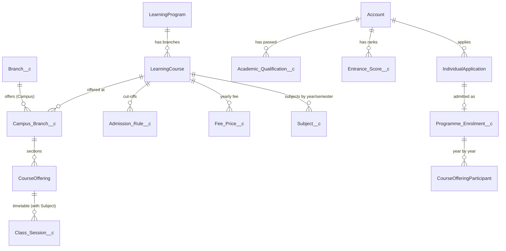
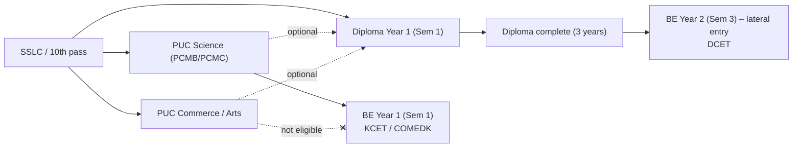
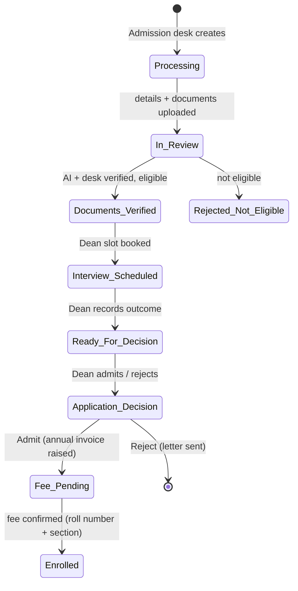

# KT College Mode — Plan and Design

_Status: **design approved for build, nothing built yet**. Written 2026-10-13 from the manager's admission flow and the decisions below. No org changes have been made for this document._

This document turns the KTEdutech solution (built for after-school learning centres) into a **college** solution for two campuses that run PUC, Diploma and BE. It is the single reference for naming, configuration, admission logic, fees, roll numbers, portals, the build plan and the demo script.

Design rules:

1. **Additive.** College mode sits next to the existing learning-centre mode. A campus is either a _Learning Centre_ or a _College_ (`Branch__c.Institution_Type__c`); everything already built keeps working for learning centres.
2. **Configurable, not coded.** Cut-offs, fees, documents, entry routes and roll-number codes are records an administrator edits. Nothing college-specific is hard-coded in Apex.
3. **Hidden back office.** Configuration lives behind the administrator persona. The demo is shown only through the front-office, Dean, faculty, accounts and student logins.
4. **Keep it simple for the demo.** Only what the manager's flow needs is in scope (Section 10 lists what is deliberately left out).

---

## 1. Standard naming (glossary)

The words "programme", "course" and "branch" mean different things in different places, so the app uses **one fixed set of words**. The demo script and every screen use these words only.

| Word in the app         | Meaning                                                                | Examples                                           | Salesforce object (API name)                         |
| ----------------------- | ---------------------------------------------------------------------- | -------------------------------------------------- | ---------------------------------------------------- |
| **Institution**         | The organisation                                                       | KT Edutech                                         | The org + `Education_Setting__mdt`                   |
| **Campus**              | A physical location                                                    | Yelahanka Campus, Rajajinagar Campus               | `Branch__c` (label changes to _Campus_)              |
| **Programme**           | The level of study                                                     | PUC, Diploma, BE                                   | `LearningProgram` (standard Education Cloud)         |
| **Branch**              | The discipline inside a programme (for PUC, the stream or combination) | Science PCMB, Commerce, CSE, Mechanical            | `LearningCourse` (label changes to _Branch_)         |
| **Academic year**       | The admission/teaching year                                            | 2026-27                                            | `Academic_Year__c` (text `YYYY-YY` on records)       |
| **Year of study**       | The student's year in the programme                                    | PUC Year 1–2, Diploma Year 1–3, BE Year 1–4        | `Year_Of_Study__c` (number) on section and enrolment |
| **Section**             | One teaching group of a branch, year and academic year at a campus     | `YLK · BE-CSE · 2026-27 · Y1 · A`                  | `CourseOffering` (label changes to _Section_)        |
| **Subject**             | A paper taught in a section                                            | Engineering Mathematics I, Physics, Accountancy    | `Subject__c` (new)                                   |
| **Entry route**         | How a student enters a programme                                       | Regular (Year 1), Lateral entry (Year 2)           | `Entry_Route__c` picklist                            |
| **Admission rule**      | The cut-off for a branch and entry route                               | BE-CSE regular: PUC PCM ≥ 90 %, KCET rank ≤ 20,000 | `Admission_Rule__c` (new)                            |
| **Qualification**       | An exam the student has already passed                                 | SSLC 2024 – 92 %; PUC Science PCMC 2026 – 88 %     | `Academic_Qualification__c` (new)                    |
| **Entrance score**      | A state/consortium entrance result                                     | KCET 2026 rank 14,210; DCET 2026 rank 3,050        | `Entrance_Score__c` (new)                            |
| **Admission**           | One application of one student to one branch, campus and entry route   | APP-000123                                         | `IndividualApplication`                              |
| **Programme enrolment** | The admitted student in a programme: holds the roll number             | KT26YBCS001                                        | `Programme_Enrolment__c` (new, see 3.4)              |
| **Section enrolment**   | The student in a section for one year                                  | KT26YBCS001 in `YLK · BE-CSE · 2026-27 · Y1 · A`   | `CourseOfferingParticipant`                          |
| **Roll number**         | The student's permanent number in a programme                          | KT26YBCS001                                        | `Programme_Enrolment__c.Roll_Number__c`              |

> "Yalahanka" is spelt **Yelahanka** (the official locality name) everywhere in the app.

### 1.1 The catalogue for both campuses

Both campuses offer the same programmes and branches, so the catalogue is defined **once** (programmes and branches are institution-wide) and each campus switches branches on through `Campus_Branch__c` (seats and status per campus).

| Programme (code)  | Duration | Terms       | Branch           | Branch code |
| ----------------- | -------- | ----------- | ---------------- | ----------- |
| **PUC** (`P`)     | 2 years  | 2 years     | Science PCMB     | `PB`        |
|                   |          |             | Science PCMC     | `PC`        |
|                   |          |             | Commerce         | `CM`        |
|                   |          |             | Arts             | `AR`        |
| **Diploma** (`D`) | 3 years  | 6 semesters | CSE              | `CS`        |
|                   |          |             | Mechanical       | `ME`        |
|                   |          |             | Electrical (EEE) | `EE`        |
| **BE** (`B`)      | 4 years  | 8 semesters | CSE              | `CS`        |
|                   |          |             | ECE              | `EC`        |
|                   |          |             | Mechanical       | `ME`        |
|                   |          |             | Civil            | `CV`        |

| Campus             | Campus code | Programmes and branches |
| ------------------ | ----------- | ----------------------- |
| Yelahanka Campus   | `Y`         | All 11 branches above   |
| Rajajinagar Campus | `R`         | All 11 branches above   |

That is 2 campuses × 11 branches = **22 campus branches**.



---

## 2. Background configuration (administrator only, hidden in the demo)

Everything in this section is edited by the administrator from the **Set-up Centre → College set-up** card (new). Demo users never see it.

### 2.1 Programme settings — `LearningProgram` (new fields)

| Field                    | Example (BE) | Use                                              |
| ------------------------ | ------------ | ------------------------------------------------ |
| `Programme_Code__c`      | `B`          | One letter in the roll number                    |
| `Duration_Years__c`      | 4            | Years of study; drives promotion and annual fees |
| `Term_Type__c`           | Semester     | Year or Semester (labels sessions and results)   |
| `Terms_Per_Year__c`      | 2            | Semesters per year                               |
| `Qualification_Level__c` | BE           | What the student holds after completing it       |
| `Active__c`              | true         |                                                  |

### 2.2 Branch settings — `LearningCourse` (new fields)

| Field                     | Example (BE-CSE) | Use                                                          |
| ------------------------- | ---------------- | ------------------------------------------------------------ |
| `Programme__c`            | BE               | Lookup to `LearningProgram`                                  |
| `Branch_Code__c`          | `CS`             | Two letters in the roll number (unique within the programme) |
| `Stream_Group__c`         | Science          | PUC only: Science / Commerce / Arts (used by entry routes)   |
| `Related_Branch_Codes__c` | `CS;EC`          | Diploma branches that may enter this BE branch laterally     |

The existing `Minimum_Age__c` / `Maximum_Age__c` stay for learning centres; college branches leave them blank.

### 2.3 Campus branch — `Campus_Branch__c` (new)

`Campus__c` (Branch\_\_c), `Branch__c` (LearningCourse), `Intake_Year_1__c` (seats), `Intake_Lateral__c` (seats), `Admissions_Open__c`, `Academic_Year__c`. Unique on campus + branch + academic year. Seats are checked when the Dean admits.

### 2.4 Campus settings — `Branch__c` (new fields)

| Field                        | College value      | Use                                                |
| ---------------------------- | ------------------ | -------------------------------------------------- |
| `Institution_Type__c`        | College            | Switches the college logic on for this campus      |
| `Campus_Code__c`             | `Y` / `R`          | One letter in the roll number                      |
| `Allowed_Payment_Methods__c` | DD; Cheque; Online | Multi-select; **Cash is not allowed** for colleges |
| `Discounts_Allowed__c`       | false              | "No bargaining": hides and blocks discounts        |

### 2.5 Admission rules (cut-offs) — `Admission_Rule__c` (new)

A cut-off is **different for each branch and entry route**, and changes every year, so it is a record (editable, versioned by academic year, with field history) rather than code or custom metadata.

| Field                    | Meaning                                                                           |
| ------------------------ | --------------------------------------------------------------------------------- |
| `Branch__c`              | The branch the rule admits to (LearningCourse)                                    |
| `Campus__c`              | Blank = both campuses; set it only if one campus has a different cut-off          |
| `Academic_Year__c`       | 2026-27                                                                           |
| `Entry_Route__c`         | Regular / Lateral                                                                 |
| `Entry_Year_Of_Study__c` | 1 for regular, 2 for lateral                                                      |
| `Qualifying_Level__c`    | SSLC / PUC / Diploma — the qualification that must be held                        |
| `Qualifying_Streams__c`  | For PUC: Science (blank = any stream); for Diploma: uses the related branch codes |
| `Min_Percentage__c`      | Minimum aggregate % in the qualifying exam                                        |
| `Entrance_Exam__c`       | None / KCET / COMEDK / DCET                                                       |
| `Max_Entrance_Rank__c`   | Highest (worst) rank accepted; blank = any valid rank                             |
| `Interview_Required__c`  | true — the Dean interview step                                                    |
| `Active__c`              |                                                                                   |

**Sample 2026-27 rules (seed values, the administrator changes them):**

| Branch                          | Route   | Needs                                             | Min % | Entrance      |
| ------------------------------- | ------- | ------------------------------------------------- | ----- | ------------- |
| PUC Science PCMB / PCMC         | Regular | SSLC                                              | 75    | —             |
| PUC Commerce                    | Regular | SSLC                                              | 50    | —             |
| PUC Arts                        | Regular | SSLC                                              | 40    | —             |
| Diploma CSE                     | Regular | SSLC                                              | 60    | —             |
| Diploma Mechanical / Electrical | Regular | SSLC                                              | 50    | —             |
| Diploma (any branch)            | Regular | PUC (any stream)                                  | 45    | —             |
| BE CSE                          | Regular | PUC Science                                       | 90    | KCET ≤ 20,000 |
| BE ECE                          | Regular | PUC Science                                       | 80    | KCET ≤ 40,000 |
| BE Mechanical                   | Regular | PUC Science                                       | 65    | KCET (any)    |
| BE Civil                        | Regular | PUC Science                                       | 60    | KCET (any)    |
| BE CSE                          | Lateral | Diploma CSE                                       | 75    | DCET ≤ 5,000  |
| BE ECE                          | Lateral | Diploma CSE or Electrical                         | 65    | DCET (any)    |
| BE Mechanical                   | Lateral | Diploma Mechanical                                | 55    | DCET (any)    |
| BE Civil                        | Lateral | Diploma Mechanical (seed; add Civil when offered) | 55    | DCET (any)    |

### 2.6 Yearly fees — `Fee_Price__c` (existing object, extended)

Fees already live in `Fee_Price__c` (by branch, campus, fee type, frequency, effective dates). Additions:

- Billing frequency value **Annual**.
- `Year_Of_Study__c` (blank = every year) so Year 1 can differ from later years.
- `Academic_Year__c` for clarity in lists (effective dates remain the real control).

**Sample 2026-27 tuition (seed values):** PUC Science 60,000 · PUC Commerce/Arts 45,000 · Diploma 75,000 · BE CSE 1,50,000 · BE ECE 1,30,000 · BE Mechanical/Civil 1,10,000 per year, plus a one-time Admission fee of 5,000. Same at both campuses unless a campus-specific price is added.

### 2.7 Documents — `Application_Checklist_Item__mdt` (existing, extended)

New fields: `Programme_Codes__c` (e.g. `P;D;B`), `Entry_Routes__c` (Regular; Lateral), `Qualifying_Levels__c` (SSLC; PUC; Diploma), `Document_Type__c` (drives the AI reader), `Applies_To__c` (Learning Centre / College). The checklist is built from every active item that matches the admission.

| Document                                 | PUC | Diploma (from SSLC) | Diploma (from PUC) | BE Year 1 (from PUC) | BE Year 2 lateral (from Diploma) |
| ---------------------------------------- | :-: | :-----------------: | :----------------: | :------------------: | :------------------------------: |
| Aadhaar card                             |  R  |          R          |         R          |          R           |                R                 |
| SSLC / 10th marks card                   |  R  |          R          |         R          |          R           |                R                 |
| Fitness (medical) certificate            |  R  |          R          |         R          |          R           |                R                 |
| Study certificate (1st–10th standard)    |  O  |          O          |         O          |          O           |                O                 |
| PAN card                                 |  O  |          O          |         O          |          O           |                O                 |
| PUC marks card                           |  –  |          –          |         R          |          R           |                –                 |
| Diploma marks cards / certificate        |  –  |          –          |         –          |          –           |                R                 |
| Entrance rank card (KCET/COMEDK or DCET) |  –  |          –          |         –          |          R           |                R                 |

R = required, O = optional. The entrance rank card is required automatically whenever the matching admission rule names an entrance exam.

**Privacy:** only the last four Aadhaar digits are stored in fields (`XXXX-XXXX-1234`); the image stays a private file on the checklist item.

---

## 3. Admission logic

### 3.1 Progression paths (entry routes)



| From                     | To               | Entry route | Starts in      | Years to finish | Conditions                                             |
| ------------------------ | ---------------- | ----------- | -------------- | --------------- | ------------------------------------------------------ |
| SSLC                     | PUC (any stream) | Regular     | Year 1         | 2               | SSLC % ≥ stream cut-off                                |
| SSLC                     | Diploma          | Regular     | Year 1 (Sem 1) | 3               | SSLC % ≥ branch cut-off                                |
| PUC (any stream)         | Diploma          | Regular     | Year 1 (Sem 1) | 3               | Optional path; PUC % ≥ rule                            |
| PUC **Science** only     | BE               | Regular     | Year 1 (Sem 1) | 4               | PUC % ≥ cut-off **and** valid KCET/COMEDK rank ≤ limit |
| PUC Commerce / Arts      | BE               | —           | —              | —               | **Not eligible** (no Science stream)                   |
| Diploma (related branch) | BE               | Lateral     | Year 2 (Sem 3) | 3               | Diploma % ≥ cut-off **and** valid DCET rank ≤ limit    |

All paths are rows in `Admission_Rule__c`, so a new path (for example a lateral entry into Diploma Year 2 for PUC Science students, if the board allows it) is added as data, not code.

### 3.2 Eligibility engine (`AdmissionEligibilityService`, new)

Runs when an admission is created or changed, when a qualification or entrance score is added, and when the AI reader verifies a document. The existing age check stays for learning-centre campuses (`ApplicationService.evaluateEligibility` hands college admissions to the new service).

For an admission (student, branch, campus, entry route, academic year):

1. Find the **active rule** for branch + entry route + academic year (campus-specific rule first, then the all-campus rule). None → `Not Eligible`: "Admissions are not open for this branch and route."
2. Find the student's **qualification** at the rule's level (`Academic_Qualification__c`), the most recent passed one.
   - Missing → `Not Checked`: "Add the PUC result to check eligibility."
   - Stream not allowed (e.g. PUC Commerce for BE) → `Not Eligible`: "BE needs PUC Science; this student studied Commerce."
   - Diploma branch not in the BE branch's related codes → `Not Eligible`.
3. Compare the **percentage**: below the cut-off → `Not Eligible` with both numbers ("BE-CSE needs 90 %; the student has 86 %").
4. If the rule names an **entrance exam**, find a valid `Entrance_Score__c` for that exam and year; missing → `Not Checked`; rank worse than the limit → `Not Eligible`.
5. Everything passes → `Eligible`, with notes listing what was checked.
6. When not eligible, the screen **suggests other branches** whose rules the student meets ("Eligible for BE Mechanical (65 %) and BE Civil (60 %)").

`Overridden` (existing value) stays available only to the Dean, with a mandatory reason.

### 3.3 Admission stages (`IndividualApplication.Status`)

Existing statuses are reused; three are added for colleges. Transitions are rows in `Status_Transition__mdt`, as today.



| Step | Who                         | What happens in the system                                                                                                                                     |
| ---- | --------------------------- | -------------------------------------------------------------------------------------------------------------------------------------------------------------- |
| 1    | Admission desk (Adam)       | **New admission** screen: student (and optional parent), campus, programme, branch, entry route; qualifications and entrance score. Live eligibility verdict.  |
| 2    | Admission desk or student   | Upload documents on the checklist (desk screen or student portal).                                                                                             |
| 3    | AI reader                   | Reads marks cards and rank cards, fills the qualification/entrance records, cross-checks name, date of birth, % and rank; marks each item Verified / Mismatch. |
| 4    | Admission desk              | Confirms the checklist → `Documents Verified` (only if eligible and all required items are verified).                                                          |
| 5    | Dean (Anjali)               | **Schedule interview** (date/time; appears in the Dean's calendar).                                                                                            |
| 6    | Dean                        | **Record interview**: Pass / Reject + remarks → **Admit** (seat taken) or **Reject** (rejection letter).                                                       |
| 7    | System                      | Admit → `Fee Pending`: annual invoice (Year-of-study tuition + admission fee) with the campus payment options.                                                 |
| 8    | Accounts (Andrea)           | Records DD / cheque / online payment; DD and cheque wait for **clearance**. On confirmation → messages (Section 4.3).                                          |
| 9    | System                      | Fee confirmed → `Programme_Enrolment__c` with **roll number** → `Enrolled`.                                                                                    |
| 10   | Dean (academic coordinator) | **Joining**: section, joining date; the student's timetable appears from the section's subject-wise weekly pattern.                                            |

New application fields: `Campus_Branch__c`, `Entry_Route__c`, `Entry_Year_Of_Study__c`, `Academic_Year__c`, `Interview_Date__c`, `Interviewer__c` (Dean), `Interview_Outcome__c` (Pass/Reject), `Interview_Remarks__c`, `Documents_Verified__c`. A custom permission **KEM_Conduct_Interview** (in the Academic Coordinator persona, so Anjali has it) guards steps 5–6.

### 3.4 Programme enrolment, roll number and progression

`Programme_Enrolment__c` (new; Private, visible through the student): `Student__c` (Account), `Programme__c`, `Branch__c`, `Campus__c`, `Application__c`, `Entry_Route__c`, `Admission_Year__c`, `Current_Year_Of_Study__c`, `Joining_Date__c`, `Status__c` (Enrolled / Completed / Discontinued), `Roll_Number__c` (Text, **unique**, external ID).

> Education Cloud's standard `ProgramEnrollment` will be checked first in phase C1 (read-only). If it is enabled and fits, the same fields go on it instead of a custom object.

**Roll number format (KT fixed):**

```
K T  2 6  Y  B  C S  0 0 1
│ │  └┬┘  │  │  └┬┘  └─┬─┘
│ │   │   │  │   │     └─ serial (3 digits) per campus+programme+branch+admission year
│ │   │   │  │   └─────── branch code (2)
│ │   │   │  └─────────── programme code (P / D / B)
│ │   │   └────────────── campus code (Y = Yelahanka, R = Rajajinagar)
│ │   └────────────────── admission year (2 digits)
└─┴────────────────────── institution, fixed "KT"
```

| Example       | Meaning                                                         |
| ------------- | --------------------------------------------------------------- |
| `KT26YBCS001` | 2026, Yelahanka, BE, CSE, first student                         |
| `KT26RPPB014` | 2026, Rajajinagar, PUC Science PCMB, 14th student               |
| `KT26YDME007` | 2026, Yelahanka, Diploma Mechanical, 7th student                |
| `KT26RBEC401` | 2026, Rajajinagar, BE ECE, **lateral entry** (serials from 401) |

Rules:

- Issued **once, when the first fee is confirmed** (not at application), so rejected or unpaid applicants never consume numbers.
- Serials come from `Roll_Number_Sequence__c` (key = year + campus + programme + branch + route band), read `FOR UPDATE` so two payments at once never get the same number; the unique field is the final guard.
- Lateral-entry serials start at **401** (configurable `Education_Setting__mdt.Roll_Lateral_Start`) so the year and route are visible from the number, as in university register numbers.
- The number **never changes** while the student stays in the programme. A new programme (e.g. Diploma → BE) gives a new programme enrolment and a new roll number; the old one stays on the completed record.
- `LearnerProfile.Student_Number__c` (STU-00001, institution-wide) remains the internal person number.

**Progression:**

- **Year-end promotion** (Dean, from the section page): passed students move to a new section enrolment for Year n+1; the programme enrolment's year increases; the next annual invoice is raised.
- **Final year** → programme enrolment `Completed` → an `Academic_Qualification__c` (level = programme, stream/branch, %) is created automatically, so a KT PUC Science or KT Diploma student can apply for BE without re-entering marks (internal progression).
- **Lateral entry** students start at Year 2; annual fees are raised for Years 2–4 only.

### 3.5 Parents and students

- The **student is the main person** (person account). For PUC students (usually minors) the New admission screen offers _Add a parent / guardian_ — **optional** for every programme.
- **Student login**: every college student can get portal access (own email; the 13+ rule already passes).
- **Parent login**: optional per family (existing _Give portal access_ on the parent).

---

## 4. Fees and payments

### 4.1 Annual invoice

`BillingService` gains an **Annual** line: one invoice per year of study, raised on admission (Year 1, or Year 2 for lateral entry) and on each promotion. No monthly runs for colleges.

### 4.2 Payment methods: DD, cheque, online — no cash, no bargaining

- New method value **Demand Draft**; new payment fields `Instrument_Number__c`, `Instrument_Bank__c`, `Instrument_Date__c` (DD / cheque).
- DD and cheque payments are recorded as **Pending** (shown as _Awaiting clearance_) and Accounts confirms them when the bank credits them (`BillingService.confirmPayment`, existing). Online (gateway, UPI, card, bank transfer) confirms as today.
- A validation (in `BillingService.recordPayment` and `StudentPaymentTriggerHandler`) refuses any method not in the campus's `Allowed_Payment_Methods__c`, so **Cash cannot be recorded** at a college campus.
- `Discounts_Allowed__c = false` hides the discount picker and blocks discount records for college campuses.

### 4.3 "Fee received" messages

On payment **confirmation** (not on entry of a pending cheque):

| To                             | Channel                                                             | Text (Message_Template\_\_mdt `Fee_Received`)                                         |
| ------------------------------ | ------------------------------------------------------------------- | ------------------------------------------------------------------------------------- |
| Student (and parent if linked) | Portal message; email/SMS only when `Email_Delivery` is switched on | "Fee received: ₹1,50,000 for BE CSE 2026-27, receipt RCT-…; roll number KT26YBCS001." |
| Admission desk + Dean          | Salesforce bell notification                                        | "Fee received for <student> (<branch>) — ready for joining."                          |
| Accounts                       | Appears in the Finance Desk "confirmed today" list                  | —                                                                                     |

### 4.4 Accounts view

Finance Desk gains a **College dues** tab: by campus → programme → branch → year, showing billed, paid, due, and DD/cheques awaiting clearance; click through to the student.

---

## 5. Teaching: sections, subjects, timetable, attendance, results

- `Subject__c` (new): `Branch__c`, `Year_Of_Study__c`, `Term__c` (semester number), `Subject_Code__c`, `Credits__c`, `Max_Marks__c`.
- Weekly patterns (`CourseOfferingSchedule`) and sessions (`Class_Session__c`) get `Subject__c`; the class set-up panel and session modal show the subject. Each period has a faculty member and room as today.
- Attendance is marked per session (existing); the portal and teacher views group it **by subject** (% per subject, overall %).
- Assessments get `Subject__c`; results show per subject and per semester; SGPA is a later item.
- The section's faculty (Tara and others) see _My sessions today_, mark attendance and enter marks — the **faculty view** (internal Lightning, not the portal).

---

## 6. Portals and apps for the demo

| Module (manager's word)    | Who logs in                    | What they see                                                                                                           | Built on                                             |
| -------------------------- | ------------------------------ | ----------------------------------------------------------------------------------------------------------------------- | ---------------------------------------------------- |
| **Admin** (admission desk) | Adam Admissions                | New admission, eligibility verdict, documents, AI check, admissions list by stage                                       | Admissions counsellor persona                        |
| **Dean**                   | Anjali Advisor                 | Interviews to schedule and record, admit/reject, joining, sections and timetable                                        | Academic coordinator persona + KEM_Conduct_Interview |
| **Teacher**                | Tara Teacher                   | Today's periods, attendance, marks                                                                                      | Teacher persona                                      |
| **Accounts**               | Andrea Advancement             | Who has paid, how much is due, DD/cheque clearance, receipts                                                            | Finance persona                                      |
| **Student portal**         | Student demo users (to create) | Roll number, today's timetable, attendance by subject, pending fees and pay online, results, upload documents, messages | `/s/my-learning` in student-first layout             |
| **Parent portal**          | Optional (Rohit/Priya style)   | The same, for their child                                                                                               | Existing guardian portal                             |

A new Lightning app **KT College** holds only: Home, Admissions, Students, Sections, Timetable, Attendance, Results, Accounts, Reports. The Set-up Centre, Operations console, AI console and configuration objects stay in the administrator's KTEdutech app — present but not shown.

---

## 7. What changes in the code (build inventory)

| Area            | Change                                                                                                                                                                                                                                                                                                | Type        |
| --------------- | ----------------------------------------------------------------------------------------------------------------------------------------------------------------------------------------------------------------------------------------------------------------------------------------------------- | ----------- |
| Objects         | `Campus_Branch__c`, `Admission_Rule__c`, `Academic_Qualification__c`, `Entrance_Score__c`, `Programme_Enrolment__c`, `Roll_Number_Sequence__c`, `Subject__c`                                                                                                                                          | New         |
| Fields          | `Branch__c`, `LearningProgram`, `LearningCourse`, `IndividualApplication`, `Fee_Price__c`, `Student_Payment__c`, `CourseOffering`, `Class_Session__c`, `CourseOfferingSchedule`, `Course_Assessment__c` (Section 2–5)                                                                                 | Additive    |
| Picklists       | Billing frequency _Annual_; payment method _Demand Draft_; application statuses _Documents Verified_, _Interview Scheduled_, _Fee Pending_                                                                                                                                                            | Additive    |
| Metadata        | Checklist items (8 college documents), status transitions, `Fee_Received` template, `Roll_Lateral_Start` setting, AI extraction prompts for marks and rank cards                                                                                                                                      | Additive    |
| Apex            | `AdmissionEligibilityService`, `RollNumberService`, `InterviewService`, `ProgressionService`, `CollegeSetupService`; hooks in `ApplicationService`, `BillingService` (record/confirm payment, annual lines), `StudentPaymentTriggerHandler`, `MessageService`, `AiExtractionService`, `PortalService` | New + hooks |
| LWC             | `kemAdmissionModal` (college New admission), `kemInterviewPanel`, `kemJoiningPanel`, `kemCollegeSetup` (admin), `kemCollegeDues`; college layout of `kemPortalHome`; subject columns in timetable/attendance/gradebook                                                                                | New + edits |
| Security        | Field and object access added to the existing personas; `KEM_Conduct_Interview` custom permission; portal read of the student's own programme enrolment                                                                                                                                               | Additive    |
| App and layouts | KT College app, layouts and list views for the new objects; labels Campus / Branch / Section                                                                                                                                                                                                          | Additive    |
| Seed            | 2 campuses, 3 programmes, 11 branches, 22 campus branches, 2026-27 rules and fees, Year-1 sections, subjects and weekly patterns, `[KEM College]` demo students                                                                                                                                       | Data        |

Every new service gets its own test class (positive, negative, bulk, permission), run class by class with the scheduled jobs paused, as for Phases 0–5.

---

## 8. Build plan

| Phase  | Scope                                                                                                                                                                                        | Done when                                                                                                             |
| ------ | -------------------------------------------------------------------------------------------------------------------------------------------------------------------------------------------- | --------------------------------------------------------------------------------------------------------------------- |
| **C1** | Naming and catalogue: campus/programme/branch/section labels, programme and branch fields, `Campus_Branch__c`, `Subject__c`, annual fees, college campus settings; check `ProgramEnrollment` | Both campuses with 11 branches, fees and sections visible in the KT College app                                       |
| **C2** | Admission: qualifications, entrance scores, admission rules, eligibility engine with suggestions, college checklist, AI marks/rank verification, Dean interview and decision                 | A BE-CSE applicant is rejected at 86 % with suggestions; a 92 % applicant reaches _Fee Pending_ after the Dean admits |
| **C3** | Fees: annual invoice, DD/cheque/online with clearance, cash and discount blocks, fee-received messages and notifications, College dues tab                                                   | Payment by DD → clearance → student and desk notified; cash refused                                                   |
| **C4** | Joining: programme enrolment, roll numbers, section assignment, joining date, subject timetable; promotion and completion → qualification                                                    | Roll number `KT26YBCS001` issued; timetable appears; lateral entrant gets `…401`                                      |
| **C5** | Portals: student-first portal (roll number, today's timetable, attendance by subject, dues, results, upload); faculty view by subject                                                        | A student logs in and sees everything in the manager's list                                                           |
| **C6** | Demo packaging: seed data, student demo users (licences — ask first), walkthrough rewrite with usernames per person, full test run                                                           | The 20-minute demo (Section 9) runs end to end with non-admin logins                                                  |

For the first manager review, **C1 → C2 → C3** shows the whole story the manager described; C4–C6 complete it.

---

## 9. Demo script (outline, 20 minutes)

| #   | Log in as (username in [NEXT-STEPS](NEXT-STEPS.md)) | Show                                                                                                                                                                                                            |
| --- | --------------------------------------------------- | --------------------------------------------------------------------------------------------------------------------------------------------------------------------------------------------------------------- |
| 1   | **Adam Admissions** — admission desk                | New admission at Yelahanka: BE-CSE, regular. PUC 86 % → _not eligible_, suggestions shown. Change to a 92 % applicant with KCET 12,400 → _eligible_. Upload Aadhaar, SSLC, PUC, KCET card, fitness certificate. |
| 2   | (AI reader, same screen)                            | Marks and rank read from the cards; one name mismatch flagged; desk confirms → _Documents Verified_.                                                                                                            |
| 3   | **Anjali Advisor** — Dean                           | Schedule the interview, record _Pass_, **Admit** → annual invoice ₹1,55,000 (tuition + admission) raised.                                                                                                       |
| 4   | **Andrea Advancement** — Accounts                   | Record a DD; try _Cash_ → refused. Clear the DD → receipt; College dues tab updates.                                                                                                                            |
| 5   | **Adam** / **Anjali**                               | Bell notification "fee received"; roll number **KT26YBCS001**; Dean assigns Section A and joining date.                                                                                                         |
| 6   | **Student** (portal)                                | Roll number, today's timetable, attendance by subject, nothing due, results, a document uploaded from the portal, the fee-received message.                                                                     |
| 7   | **Tara Teacher** — faculty                          | Today's periods, mark attendance, enter marks → the student sees them.                                                                                                                                          |
| 8   | **Adam** — lateral entry (optional)                 | Diploma CSE graduate, DCET rank → BE-CSE Year 2 → roll number `KT26YBCS401`; PUC Commerce student → BE refused.                                                                                                 |

The administrator (Kasetti Tech) is never used in the demo.

---

## 10. Deliberately out of scope (for now)

Super-admin and configuration screens in the demo; category/reservation quotas and government seat matrices; university (VTU/DTE) registration and results integration; DigiLocker verification of certificate authenticity (the AI checks consistency, not authenticity); hostel; scholarships; SGPA/CGPA calculation; transport, library and referrals (they remain available but are not shown).

---

## 11. Decisions recorded (2026-10-13)

| Question     | Decision                                                                                          |
| ------------ | ------------------------------------------------------------------------------------------------- |
| Names        | Campus → Programme → Branch → Section → Subject (Section 1); defined once in this document        |
| Campuses     | Yelahanka and Rajajinagar, each with PUC (4 branches), Diploma (3) and BE (4)                     |
| Cut-offs     | Configurable per branch, entry route, academic year (and optionally campus) — `Admission_Rule__c` |
| Yearly fee   | Configurable per branch, campus, year of study — `Fee_Price__c` (Annual)                          |
| Documents    | Section 2.7; PUC/Diploma certificates and entrance rank cards added for BE by entry route         |
| Progression  | Section 3.1, including optional PUC → Diploma and Diploma → BE lateral entry (Year 2)             |
| Roll number  | `KT` + year + campus + programme + branch + serial; lateral serials from 401                      |
| Dean         | Anjali Advisor (academic coordinator persona + `KEM_Conduct_Interview`)                           |
| Parent login | Optional for every programme, including PUC                                                       |
| Org changes  | None yet; build starts at C1 when approved                                                        |
